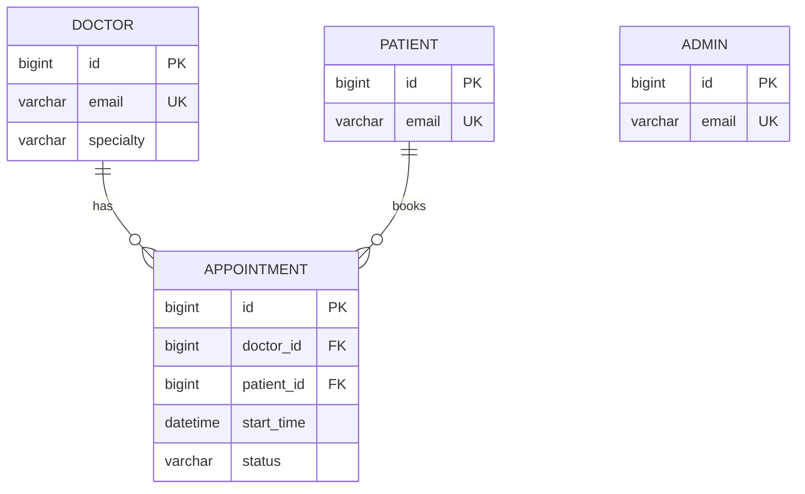

# Schema Design

The application uses two databases:

- **MySQL** (`capstone`) for structured, relational data that needs foreign keys and transactions.
- **MongoDB** (`clinic_prescriptions`) for prescriptions, whose medicine lists are flexible, nested documents.

Scripts: `database/schema.sql` (tables), `database/sample-data.sql`, `database/stored-procedures.sql`. The JPA entities in `app/src/main/java/com/project/back_end/models` use exactly the same table, column, index and constraint names.

## MySQL Database Design

### Table: `admin`
**Purpose:** clinic administrators who can log in and manage doctors. Rows are created by a seed script / database administrator only (no public registration).

| Column | Type | Constraints |
|---|---|---|
| id | BIGINT | **Primary key**, AUTO_INCREMENT |
| name | VARCHAR(100) | NOT NULL |
| email | VARCHAR(150) | NOT NULL, **UNIQUE** (`uk_admin_email`) |
| password_hash | VARCHAR(100) | NOT NULL (BCrypt hash, never plain text) |
| created_at | DATETIME(6) | NOT NULL, default current timestamp |

**Foreign keys:** none. **Relationships:** none.

### Table: `doctor`
**Purpose:** doctors, their specialty, login and weekly availability (Monday-Friday between `available_from` and `available_to`).

| Column | Type | Constraints |
|---|---|---|
| id | BIGINT | **Primary key**, AUTO_INCREMENT |
| name | VARCHAR(100) | NOT NULL, indexed (`idx_doctor_name`) |
| specialty | VARCHAR(100) | NOT NULL, indexed (`idx_doctor_specialty`) |
| email | VARCHAR(150) | NOT NULL, **UNIQUE** (`uk_doctor_email`) |
| password_hash | VARCHAR(100) | NOT NULL |
| phone | VARCHAR(20) | NULL |
| available_from | TIME(6) | NOT NULL, default 09:00 |
| available_to | TIME(6) | NOT NULL, default 17:00; CHECK `available_from < available_to` |
| active | BIT(1) | NOT NULL, default 1 (inactive doctors cannot be booked) |
| created_at | DATETIME(6) | NOT NULL, default current timestamp |

**Foreign keys:** none. **Relationships:** one doctor has many appointments (`appointment.doctor_id`).

### Table: `patient`
**Purpose:** registered patients (created through public registration or the seed script).

| Column | Type | Constraints |
|---|---|---|
| id | BIGINT | **Primary key**, AUTO_INCREMENT |
| name | VARCHAR(100) | NOT NULL, indexed (`idx_patient_name`) |
| email | VARCHAR(150) | NOT NULL, **UNIQUE** (`uk_patient_email`) |
| password_hash | VARCHAR(100) | NOT NULL |
| phone | VARCHAR(20) | NULL |
| date_of_birth | DATE | NULL |
| address | VARCHAR(255) | NULL |
| created_at | DATETIME(6) | NOT NULL, default current timestamp |

**Foreign keys:** none. **Relationships:** one patient has many appointments (`appointment.patient_id`).

### Table: `appointment`
**Purpose:** one booked 30-minute slot between one patient and one doctor, with its lifecycle status.

| Column | Type | Constraints |
|---|---|---|
| id | BIGINT | **Primary key**, AUTO_INCREMENT |
| doctor_id | BIGINT | NOT NULL, **FK -> doctor(id)** (`fk_appointment_doctor`) |
| patient_id | BIGINT | NOT NULL, **FK -> patient(id)** (`fk_appointment_patient`) |
| start_time | DATETIME(6) | NOT NULL (clinic-local time) |
| end_time | DATETIME(6) | NOT NULL; CHECK `start_time < end_time` |
| status | VARCHAR(20) | NOT NULL, default `SCHEDULED`; CHECK in (`SCHEDULED`,`COMPLETED`,`CANCELLED`,`NO_SHOW`) |
| reason | VARCHAR(255) | NULL |
| created_at | DATETIME(6) | NOT NULL |
| updated_at | DATETIME(6) | NOT NULL |

**Indexes:** `idx_appointment_doctor_start (doctor_id, start_time)` (conflict checks, daily reports), `idx_appointment_patient_start (patient_id, start_time)`, `idx_appointment_status (status)`.

**Relationships:** many-to-one to `doctor`, many-to-one to `patient`. Doctors and patients that have appointments cannot be deleted at the database level (no cascade), which preserves history.

**Overlap rule:** a doctor (and a patient) may not have two non-cancelled appointments that overlap in time. This is enforced in `AppointmentService` inside a transaction that locks the doctor row (`SELECT ... FOR UPDATE`), because MySQL cannot express "no overlapping ranges" as a simple unique constraint.

### Entity relationship overview



## MongoDB Collection Design

**Database:** `clinic_prescriptions` **Collection:** `prescriptions`

**Why MongoDB:** a prescription contains a variable-length list of medicines. Storing it as one nested document avoids a join table and reads in a single lookup. The IDs `appointmentId`, `patientId`, `doctorId` are the MySQL primary keys (a logical reference; MongoDB does not enforce it, so `PrescriptionService` verifies the appointment exists and belongs to the doctor before saving).

| Field | Type | Notes |
|---|---|---|
| `_id` | ObjectId | generated by MongoDB (exposed as `id`) |
| `appointmentId` | Long | MySQL `appointment.id`, indexed |
| `patientId` | Long | taken from the appointment (not from the client), indexed |
| `doctorId` | Long | taken from the logged-in doctor, indexed |
| `medicines` | array of objects | each: `name`, `dosage`, `frequency`, `duration` (all required) |
| `instructions` | String | optional, max 1000 characters |
| `createdAt` | Date | set on creation |
| `updatedAt` | Date | set on every update |
| `_class` | String | added automatically by Spring Data |

Validation: enforced by Bean Validation on the request DTOs (at least one medicine; every medicine field non-blank, max 100 characters; instructions max 1000).

**Example document**

```json
{
  "_id": { "$oid": "6720f1c2a1b2c3d4e5f60718" },
  "appointmentId": 3,
  "patientId": 3,
  "doctorId": 1,
  "medicines": [
    {
      "name": "Atorvastatin",
      "dosage": "20 mg",
      "frequency": "Once daily at night",
      "duration": "30 days"
    },
    {
      "name": "Aspirin",
      "dosage": "75 mg",
      "frequency": "Once daily after breakfast",
      "duration": "30 days"
    }
  ],
  "instructions": "Avoid fatty food. Return for a check-up after 4 weeks.",
  "createdAt": { "$date": "2026-08-11T11:40:00Z" },
  "updatedAt": { "$date": "2026-08-11T11:40:00Z" },
  "_class": "com.project.back_end.models.Prescription"
}
```
